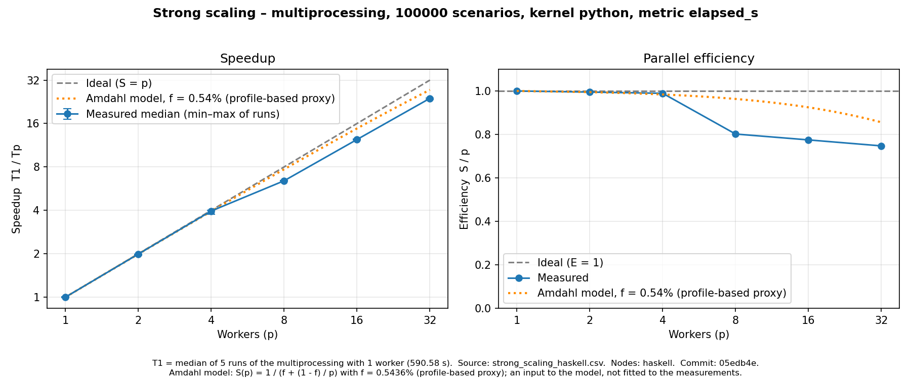

# Strong-Scaling Interpretation: Amdahl Comparison and Resource Choice

**November 17, 2026 checkpoint.** This document interprets the first strong-scaling experiment. It does not repeat the experiment: all numbers come from the existing measurements in `docs/timings/strong_scaling_haskell.csv` (100,000 scenarios, seed 42, Python kernel, node `haskell`, five repetitions per configuration, Slurm jobs 30693–30699).

The serial-fraction estimates used here come from [serial_fraction_estimate.md](serial_fraction_estimate.md), which has been reviewed by the team. The profile-based value remains a proxy, not a proven theoretical constant. If those estimates change, the figure and tables below must be regenerated with the commands in Section 6.

## 1. Which Amdahl estimate we compare against, and why

Amdahl's law predicts the speedup with `p` workers from a serial fraction `f`:

```
S(p) = 1 / (f + (1 - f) / p)
```

We have two estimates of `f` (see [serial_fraction_estimate.md](serial_fraction_estimate.md)):

| Estimate | Value | How it was obtained | Used here as |
|---|---:|---|---|
| Profile-based proxy | 0.54% | Share of the sequential profiling run spent on loading, scenario generation and writing | **Model input** for the Amdahl prediction line |
| Effective Amdahl fraction | 3.53% (8), 1.94% (16), 1.09% (32 workers) | Calculated back from the measured speedups | Reported in a table only, **not** drawn as a prediction |

We draw only the profile-based value as a prediction because it was measured independently of the scaling runs. The effective fraction is calculated from the same speedups we want to explain, so a curve drawn with it would match the measurements by construction. It describes the result rather than predicting it.

**Assumptions behind the model line:**

- Loading, scenario generation and writing are treated as fully serial, and all the shortest-path computation as perfectly parallel. In reality scenario generation could also be parallelised, so 0.54% is an approximation, not the program's true unavoidable serial work.
- The profile comes from a sequential run (603.7 s), while the speedups use the one-worker multiprocessing run (590.58 s) as the baseline. The two runs were made under different conditions.
- Amdahl's law ignores any overhead that grows with the number of workers, such as starting the worker pool.

## 2. Measured speedup against the Amdahl model



The figure keeps the original measured and ideal curves (median of five runs, min–max bars, one-worker multiprocessing baseline) and adds the Amdahl prediction for `f = 0.54%`. The numbers behind it are in [plots/strong_scaling_elapsed_s_amdahl.csv](plots/strong_scaling_elapsed_s_amdahl.csv).

| Workers | Median time (s) | Measured speedup | Amdahl speedup (f = 0.54%) | Measured / Amdahl | Measured efficiency | Amdahl efficiency |
|---:|---:|---:|---:|---:|---:|---:|
| 1 | 590.58 | 1.00 | 1.00 | 100.0% | 100.0% | 100.0% |
| 2 | 296.81 | 1.99 | 1.99 | 100.0% | 99.5% | 99.5% |
| 4 | 149.24 | 3.96 | 3.94 | 100.5% | 98.9% | 98.4% |
| 8 | 92.06 | 6.42 | 7.71 | 83.2% | 80.2% | 96.3% |
| 16 | 47.64 | 12.40 | 14.79 | 83.8% | 77.5% | 92.5% |
| 32 | 24.70 | 23.91 | 27.39 | 87.3% | 74.7% | 85.6% |

**What this shows:**

- Up to 4 workers, the measurements match both the ideal line and the Amdahl model closely (at 4 workers the measured speedup is approximately 0.5% above the model: 3.957 against 3.936).
- Between 4 and 8 workers, efficiency drops suddenly from 98.9% to 80.2%, then declines slowly to 74.7% at 32 workers.
- The Amdahl model with `f = 0.54%` predicts a gradual decline, not a sudden step. At 8 to 32 workers, the measured speedup is only 83–87% of the model's prediction.
- So a fixed serial fraction of 0.54% cannot explain the measured result. Something that grows with the number of workers is also slowing the program down.

## 3. What is measured, and what is not yet explained

The timing CSV records each part of a run separately, so we can see where the extra time goes. "Ideal" below means the one-worker time divided by `p`. All values are medians of five runs.

| Workers | Measured time (s) | Ideal time (s) | Extra time (s) | Pool start-up (s) | Extra time inside computation (s) |
|---:|---:|---:|---:|---:|---:|
| 2 | 296.81 | 295.29 | 1.51 | 0.10 | 1.40 |
| 4 | 149.24 | 147.65 | 1.60 | 0.17 | 1.36 |
| 8 | 92.06 | 73.82 | 18.24 | 0.34 | 17.81 |
| 16 | 47.64 | 36.91 | 10.73 | 0.67 | 9.95 |
| 32 | 24.70 | 18.46 | 6.24 | 1.33 | 4.80 |

Extra time inside computation = median `compute_s` with `p` workers minus the one-worker median `compute_s` divided by `p`.

`compute_s` covers the whole parallel phase: the workers running their scenarios **and** the collection of their results by the main process. It therefore shows how much extra time is spent in that phase, but not which part of it (the work itself, waiting for the slowest worker, or collecting results) is responsible.

**Measured overhead (evidence):**

- **Pool start-up** grows with the number of workers, from 0.10 s at 1 worker to 1.33 s at 32. This is a directly measured overhead. Amdahl's law does not include it.
- Pool start-up explains only a small part of the lost time: 0.34 s of 18.24 s at 8 workers, and 1.33 s of 6.24 s at 32 workers.
- **Most of the lost time is inside the computation phase** (17.81 s at 8 workers, 4.80 s at 32). Because `compute_s` includes both worker execution and result collection, these timers locate the extra time but do not establish its root cause.

**Possible explanations we have not yet tested (hypotheses, not findings):**

- **Shared hardware.** More active workers share memory bandwidth and caches, and the CPU clock speed can drop when many cores are busy.
- **Contention for shared resources on the node.** The median one-minute node load was about 5 for the one-worker runs and 13–20 for the 2- to 32-worker runs. Node load counts all processes on the whole node, including our own workers, so it does not show that other jobs ran on the cores allocated to us. Contention with other work on the node is therefore a hypothesis, not something our measurements establish.
- **How the work is split.** If the scenarios are divided unevenly, some workers finish early and wait.

Possible checks before the final report: repeat the 4- and 8-worker runs on an idle node, compare `compute_s` per scenario per worker, and test different chunk sizes. Until then, we report the step at 8 workers as **observed but not explained**.

## 4. Resource choice: wall time against allocated core-time

On this cluster each worker gets one physical core, which Slurm counts as 2 CPUs. *Worker-seconds* is workers × median elapsed time (`elapsed_s`). It is the **core-time allocated** to a run, not measured CPU utilisation: it counts the cores reserved for the whole run, whether or not they were busy, and it excludes the time a job waits in the queue.

| Workers | Median time (s) | Speedup | Efficiency | Allocated worker-seconds | Allocated Slurm CPU-hours (2 CPUs per worker) |
|---:|---:|---:|---:|---:|---:|
| 1 | 590.58 | 1.00 | 100.0% | 590.6 | 0.33 |
| 2 | 296.81 | 1.99 | 99.5% | 593.6 | 0.33 |
| 4 | 149.24 | 3.96 | 98.9% | 597.0 | 0.33 |
| 8 | 92.06 | 6.42 | 80.2% | 736.5 | 0.41 |
| 16 | 47.64 | 12.40 | 77.5% | 762.2 | 0.42 |
| 32 | 24.70 | 23.91 | 74.7% | 790.3 | 0.44 |

**Interpretation:**

- **Up to 4 workers, extra workers are almost free.** The allocated core-time stays at about 590–597 worker-seconds, so the answer arrives faster at almost no extra cost.
- **From 8 workers, each run needs more allocated core-time.** It goes from about 597 worker-seconds at 4 workers to 737 at 8, which is 23% more for the same work. This is the price of the efficiency drop.
- **Past 8 workers, the extra cost is small compared with the time saved.** Going from 8 to 32 workers cuts the wall time from 92.06 s to 24.70 s (3.7 times faster) for only 7% more allocated core-time (736.5 to 790.3 worker-seconds).

**Which configuration to choose depends on the goal:**

- **One answer as fast as possible:** 32 workers (24.70 s). However, 32 workers need 64 CPUs, which is the per-user maximum, so the JupyterLab session must be stopped and the job may wait longer in the queue.
- **Many independent runs with a fixed core-time budget**, for example many seeds or datasets: 4 workers per run gives the most work per CPU (98.9% efficiency). Several 4-worker jobs can run side by side within the 64-CPU limit.
- **A middle ground:** 16 workers (47.64 s, 77.5% efficiency) uses half the per-user CPU limit and leaves room for another job.

The example from class (8 workers at 80% efficiency against 16 workers at 50%) is an illustration, not our result. In our measurements, efficiency stays between 75% and 80% from 8 to 32 workers, so higher worker counts remain worthwhile.

## 5. Open question for the November 17 deliverable

The class slide shows three curves: measured, ideal and Amdahl. The figure above includes all three. We still need to confirm whether the Amdahl curve is required in the November 17 submission, or whether the measured-against-ideal plot in [plots/strong_scaling_elapsed_s.png](plots/strong_scaling_elapsed_s.png) is enough.

## 6. Reproducing the figure and tables

From the repository root:

```bash
python scripts/plot_scaling.py docs/timings/strong_scaling_haskell.csv \
    --scenarios 100000 --kernel python --baseline multiprocessing \
    --amdahl-f 0.005436 --amdahl-label "profile-based proxy" --out-dir docs/plots
python scripts/estimate_serial_fraction.py
```

The first command writes `docs/plots/strong_scaling_elapsed_s_amdahl.png` and `.csv`. The original plot `docs/plots/strong_scaling_elapsed_s.png` is not changed. The second command prints the pool start-up, computation and serial-fraction values used in Sections 1 and 3.

## AI USE AND REFERENCES

The initial draft of this interpretation and of the Amdahl comparison option in `scripts/plot_scaling.py` was developed with assistance from Claude (Anthropic, https://claude.ai).

I used Claude to understand how to compare the measured speedup with Amdahl's law, decide which serial-fraction estimate is appropriate as a model input, calculate the time breakdown and resource costs from the timing CSV, and improve and correct the wording of the documentation. I also used Claude to help with the structure and layout of the documentation and to clean it up. After Alexandra's review on 17 Nov, I also used Claude to make the wording more precise (allocated core-time, what node load and `compute_s` can and cannot show).

I also checked the tables against `docs/timings/strong_scaling_haskell.csv` and the output of `scripts/estimate_serial_fraction.py`.

Prompts included requests to read `docs/serial_fraction_estimate.md`, `docs/benchmarking.md` and the timing CSV, add an Amdahl prediction to the existing scaling plot, separate measured overhead from untested explanations, and explain the trade-off between wall time and CPU resources.

**References**

- Matteo Turilli, *Operating Systems and Parallel Computing Group Assignment: Parallel Data Analytics on the HPC Cluster*.
- [Serial fraction estimation](serial_fraction_estimate.md)
- [Benchmarking](benchmarking.md)
- [Raw timing measurements](timings/strong_scaling_haskell.csv)
- G. M. Amdahl, "Validity of the single processor approach to achieving large scale computing capabilities", *AFIPS Conference Proceedings*, 1967.
